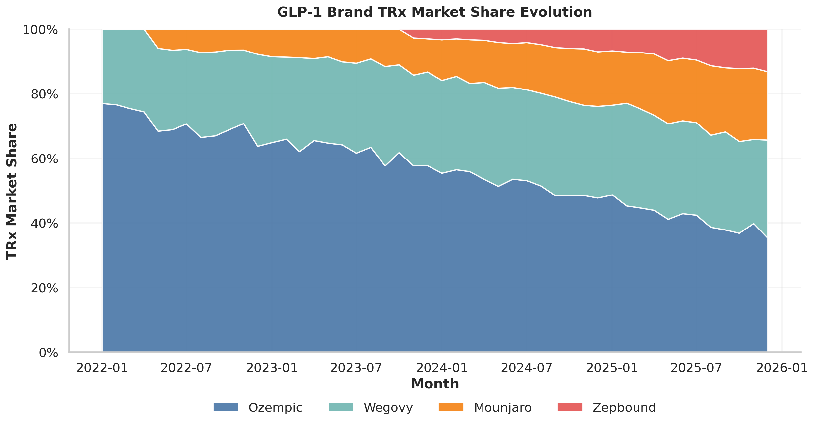

# GLP-1 Market Lab

**A healthcare analytics portfolio project on brand competition, forecast reliability, and companion nutrition.**

I wanted to answer a question a commercial analyst might get after presenting a forecast: if access or competition changes, which part of the forecast should we revisit first?

This project simulates monthly prescriptions for Ozempic, Wegovy, Mounjaro, and Zepbound, alongside three companion nutrition categories. It uses 48 months of synthetic history from January 2022 to December 2025 and projects 24 months through December 2027. The forecasts, historical inputs, and scenario results are synthetic. The dashboard also includes [public U.S. benchmarks](https://rayanatwork2004-alt.github.io/glp1-market-dynamics-forecasting/#evidence) for reported Wegovy volume, Foundayo affordability, and clinical trial results. Each benchmark links to its source. The four brands define the modeled panel. The data do not distinguish individual indications or count unique patients.

## Explore the dashboard

**[Open the live dashboard](https://rayanatwork2004-alt.github.io/glp1-market-dynamics-forecasting/)**

Run the pipeline and open `outputs/dashboard.html` in a browser. The file works offline and includes three interactive views. You can also open a successful **Portfolio checks** run in the repository’s **Actions** tab, download the **glp1-market-lab** artifact, and open `dashboard.html` from the extracted folder.

| View | Question it answers |
| --- | --- |
| U.S. market benchmarks | What do real prescription volume estimates, published patient costs, and trial results tell us about competition and access? |
| Simulated market overview | Which brands gained share within this panel, and which manufacturers own them? |
| Forecast audit | Does SARIMAX beat the last observed value at the lead time I care about? How often do the intervals cover the simulated outcomes? |
| Scenario explorer | How much of the difference from the base comes from more prescriptions, a shift between manufacturers, or a change in revenue per prescription? |



## How I built it

- **Market data.** A seeded simulation generates monthly total prescriptions (TRx), new prescriptions (NRx), synthetic prices and sales. Structural zeroes before modeled launch are preserved for share calculations and removed from forecast training.
- **Forecast validation.** I keep the original log SARIMAX approach and reselect model orders within each training window. Every three months, I compare the model with a last value baseline at 1, 3 and 6 months ahead. I report MAE, RMSE, WAPE, signed bias and observed coverage of the 80% and 95% prediction intervals.
- **Commercial scenarios.** I separate changes in total prescriptions from shifts between manufacturers and changes in synthetic gross revenue per prescription. This lets a reader see how rising volume and falling revenue per prescription can pull in different directions. The nutrition adjustment uses a declared sensitivity and starts after the configured lag.
- **Research boundaries.** The nutrition relationship was built into the simulation. Comparing levels with monthly changes helps explain why two upward trends can look related. Neither correlation establishes a real commercial effect. The model uses aggregate synthetic records and contains no patient data.

## How I’d use it

I’d check the audit at the planning horizon before using a model. If SARIMAX misses more often or loses to the simple baseline, I’d show both estimates and explain the difference. I’d revisit the forecast after a meaningful coverage or supply change because the model learns from the simulated history it has seen. A short backtest also gives limited evidence about coverage, especially for newer brands.

I’d read the scenario output as a sensitivity exercise. A shift in share can change concentration without changing total prescriptions. A larger prescription forecast does not tell me how many patients can access treatment, how long they wait, or whether access differs across groups. Answering those questions would require real coverage, dispensing, and population data at the right level.

## Run locally

```bash
git clone https://github.com/rayanatwork2004-alt/glp1-market-dynamics-forecasting.git
cd glp1-market-dynamics-forecasting
python -m venv .venv
```

Activate the environment with `.\.venv\Scripts\Activate.ps1` on Windows PowerShell or `source .venv/bin/activate` on macOS or Linux.

```bash
python -m pip install -e ".[dev]"
python run_pipeline.py
python -m pytest
```

The pipeline saves the interactive dashboard, the original static charts, and CSVs for the scorecard, individual held out predictions and commercial scenarios. The Python package lives in [src/glp1_market](src/glp1_market), with the method and metric definitions in [docs](docs).

The forecast comparison reflects the methods I wanted to practice from ADM 4307. The research framing, data limitations and access questions reflect the healthcare management lens I wanted to bring from ADM 4364. [Telfer Healthcare Analytics](https://telfer.uottawa.ca/en/bcom/your-program-of-study/program-structure/healthcare-analytics/)
