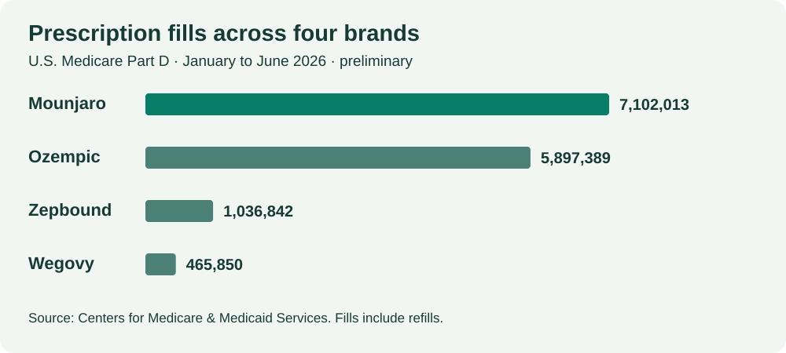

# GLP-1 Market Lab

**A healthcare analytics project using public Medicare Part D claims to study prescription demand.**

## What the Medicare data showed

**Mounjaro accounted for 49% of Medicare Part D fills among the four brands I tracked from January to June 2026.** CMS reported about 7.1 million Mounjaro fills in that preliminary period. The share is for these four brands within Medicare Part D. Fills include refills and can cover different treatment uses.



I also tested two simple forecasts against published Ozempic counts. The trend forecast had **22.1% WAPE**, compared with **40.5%** for repeating the previous year. Lower WAPE means smaller misses relative to total fills. I had three annual tests, so I’d want more history before using the result to plan. [Medicare methods and sources](docs/medicare.md)

This is my first healthcare analytics project. I combined what I learned in school with my own research into the pharmaceutical industry. An obesity market brief made me curious about what drives prescription demand. New treatments give patients more choices, and insurance coverage can affect which medicines they can get. I also wanted to explore whether growth in prescriptions could affect demand for related nutrition products.

My main question was simple. If coverage or competition changes, what should I look at first to understand prescription demand?

I use published Medicare Part D data to compare fills and spending for Ozempic, Wegovy, Mounjaro, and Zepbound and test simple forecasts where the annual history allows it. The dashboard also includes public U.S. benchmarks for reported Wegovy volume, Foundayo affordability, and clinical trial results. A separate simulation uses 48 months of synthetic history to explore how changes in volume, share, and pricing could affect a forecast. The companion nutrition response is an assumption in that simulation and would need independent sales data to test.

## Explore the dashboard

**[Open the interactive dashboard](https://rayanatwork2004-alt.github.io/glp1-market-dynamics-forecasting/?v=interaction-review)**

Start with **Medicare Part D** for published fills, spending, and the annual forecast test. The simulation is a separate exercise.

| View | Question it answers |
| --- | --- |
| Medicare Part D (Prescription Drug Coverage) | How have real fills and spending changed for four selected brands, and how well do simple forecasts track them? |
| Medicaid | How did published quarterly prescription counts change across the same four brands in a separate public program? |
| Canada context | What does the new Canadian semaglutide advisory tell us, and what evidence would we need to study its effects? |
| U.S. market benchmarks | What do real prescription volume estimates, published patient costs, and trial results tell us about competition and access? |
| Simulated market overview | Which brands gained share within this panel, and which manufacturers own them? |
| Forecast audit | Does SARIMAX beat the last observed value for the month I’m trying to predict? How often does the forecast range contain the simulated result? |
| Scenario explorer | How much of the difference from the base comes from more prescriptions, a shift between manufacturers, or a change in revenue per prescription? |

## Simulation demo


In the simulation, Wegovy prescriptions rose from **972,443 in October 2025** to **992,972 in November**, while its share of the four brands fell from **28.4% to 26.1%**. The panel grew faster than Wegovy did. If I only looked at share, I’d miss that Wegovy’s prescription volume actually went up.

## How I built it

- **Real claims.** I use the published total for each brand. The annual figures let me compare full years. I show newer figures separately because they can be revised and may cover only part of a year. I calculate share only when all four brands have reported fills. Where I have enough history, I test whether a simple trend predicts the next year better than repeating the previous year. [Medicare methods and sources](docs/medicare.md)

- **Market data.** I generate monthly prescription counts, prices, and sales for the simulation. Months before a brand enters the simulated market count as zero for market share. I start training the forecast when the brand enters.
- **Forecast validation.** I use SARIMAX to forecast each brand from its own simulated history. I hide later months, make a forecast, and compare it with a simple guess that repeats the latest month. I check how far each guess was off, whether it tended to predict too high or too low, and how often the answer fell inside the forecast range. [Forecast methods](docs/methodology.md)
- **Commercial scenarios.** I separate changes in total prescriptions from shifts between manufacturers and changes in synthetic gross revenue per prescription. This lets a reader see how rising volume and falling revenue per prescription can pull in different directions. I choose how strongly simulated nutrition sales respond to a prescription change and how long that response takes.
- **Research boundaries.** The nutrition relationship was built into the simulation. Comparing levels with monthly changes helps explain why two upward trends can look related. Neither correlation establishes a real commercial effect. The model uses aggregate synthetic records and contains no patient data.

## How the simulated forecast performed

The synthetic forecast audit is a methods exercise with limited evidence for newer brands. For Zepbound, SARIMAX had 0.3% WAPE at three months ahead and 21.6% at six months, compared with 30.6% and 39.5% for the last value baseline. Each comparison used only one simulated test month. Those scores describe that single test and give little evidence about future reliability. The dashboard shows the number of distinct test months beside each selection.

## What I’d ask for on day one

- **Monthly prescription fills by brand** to test the forecast against real dispensing data.
- **Insurer coverage change dates** to check whether fill patterns shifted afterward and what else changed at the same time.
- **Independent nutrition sales** to see whether actual purchases show the kind of lag I simulated.

## Run locally

The default local build includes the simulation. GitHub Actions includes both public claims panels automatically. For a local build with public claims, run `python -m glp1_market.medicare` and `python -m glp1_market.medicaid` after installation. Set `GLP1_MEDICARE_DATA=.cache/medicare.json` and `GLP1_MEDICAID_DATA=.cache/medicaid.json` in your shell before running the pipeline.

Run the pipeline and open `outputs/dashboard.html` in a browser. The dashboard also works offline. You can also open a successful **Portfolio checks** run in the repository’s **Actions** tab, download the **glp1-market-lab** artifact, and open `dashboard.html` from the extracted folder.

```bash
git clone https://github.com/rayanatwork2004-alt/glp1-market-dynamics-forecasting.git
cd glp1-market-dynamics-forecasting
python -m venv .venv
```

Activate the environment with `.\.venv\Scripts\Activate.ps1` on Windows PowerShell or `source .venv/bin/activate` on macOS or Linux.

```bash
python -m pip install -e ".[dev]"
python run_pipeline.py
python -m pytest
```

The pipeline saves the interactive dashboard, the original static charts, and CSVs for the forecast scores, predictions, and scenarios. The Python package lives in [src/glp1_market](src/glp1_market), with the method and metric definitions in [docs](docs).


GitHub Actions also opens the generated dashboard in Chromium and checks the selectors, moving period markers, visible forecast points, downloads, keyboard controls, and mobile layout. Publication waits for those checks to pass.
